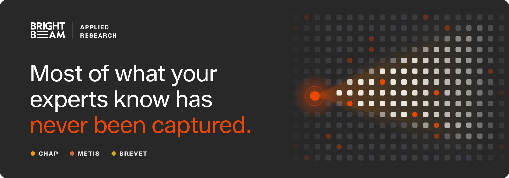
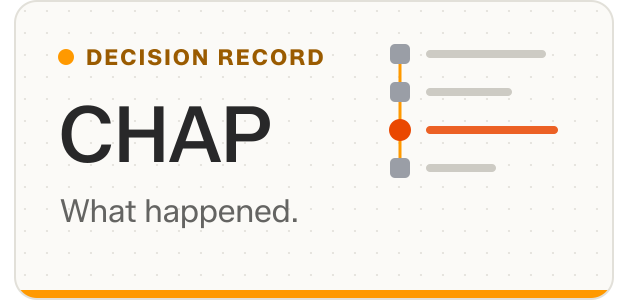
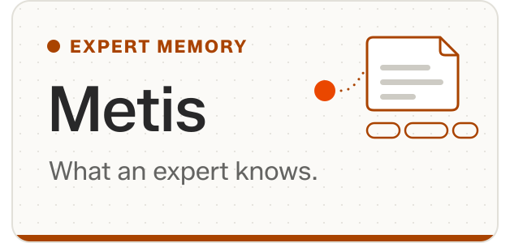
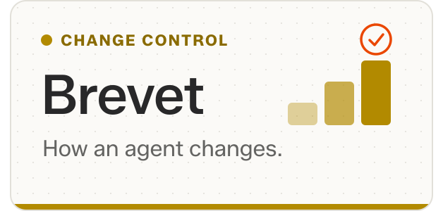
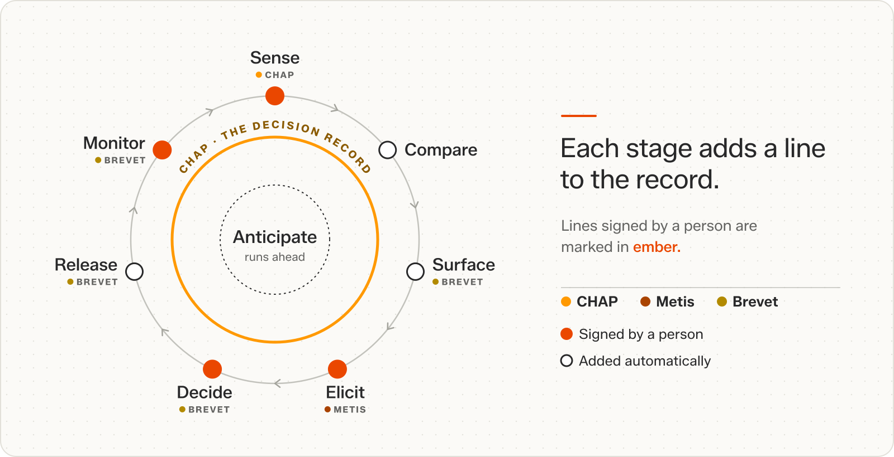

<p align="center">
  <a href="https://brightbeam.works">
    
  </a>
</p>

<p align="center">
  <a href="https://brightbeam.works"><b>brightbeam.works</b></a>
  &nbsp;·&nbsp;
  <a href="https://brightbeam.works/papers/">Papers</a>
  &nbsp;·&nbsp;
  <a href="https://brightbeam.works/writing/">Writing</a>
  &nbsp;·&nbsp;
  <a href="https://www.linkedin.com/company/brightbeam-ai/">LinkedIn</a>
  &nbsp;·&nbsp;
  <a href="https://www.brightbeam.com/contact-us">Work with us</a>
</p>

Digital intelligence is becoming abundant, and organisations will soon run thousands of agents alongside their people. Our open-source projects build oversight into the work: every agent has clear limits, a named owner and a record, and nothing it learns spreads until a person approves it. The projects come from the research behind Brightbeam's [Continuous Intelligence Operations](https://brightbeam.works/#ci-ops), the discipline of operating digital intelligence in live work and improving it continuously from the evidence that work produces.

## Projects

<p align="center">
  <a href="https://github.com/BrightbeamAI/chap"><picture><source media="(prefers-color-scheme: dark)" srcset="./assets/card-chap-dark.svg"></picture></a>
  <a href="https://github.com/BrightbeamAI/metis"><picture><source media="(prefers-color-scheme: dark)" srcset="./assets/card-metis-dark.svg"></picture></a>
  <a href="https://github.com/BrightbeamAI/brevet"><picture><source media="(prefers-color-scheme: dark)" srcset="./assets/card-brevet-dark.svg"></picture></a>
</p>

- **[CHAP](https://github.com/BrightbeamAI/chap)** is an open protocol that gives approvals, overrides and handoffs between people and agents one auditable shape, beside MCP and A2A. [Overview](https://brightbeam.works/chap/)
- **[Metis](https://github.com/BrightbeamAI/metis)** captures what experts notice and do as tacit fragments, each with its source and the conditions for using it. People decide which ones an agent may use. [Overview](https://brightbeam.works/metis/)
- **[Brevet](https://github.com/BrightbeamAI/brevet)** is a local-first Python runtime that turns corrections into proposed rules. A named person approves each one, approved rules ship in signed releases, and any rule can be recalled. [Overview](https://brightbeam.works/brevet/)

## How they connect

<picture>
  <source media="(prefers-color-scheme: dark)" srcset="./assets/loop-dark.svg">
  
</picture>

A quality reviewer changes an agent's rating from minor to major, because a pump that vibrates during cleaning may have a worn seal. The loop turns her correction into a rule the agent may use, and takes the rule back when the evidence turns against it.

<details>
<summary><b>Follow the correction around the loop</b></summary>
<br>

1. **Sense.** CHAP records the agent's rating, the reviewer's change and her reason.
2. **Compare.** Her ratings are compared with the agent's across similar reports. Four disagree, for the same reason.
3. **Surface.** Brevet turns the four corrections into one proposal for the quality owner. The agent keeps its current release.
4. **Elicit.** At a natural pause, Metis asks the reviewer one short question and keeps her answer as a tacit fragment.
5. **Decide.** The quality owner, not the agent, approves the rule, with tests built from the four reports.
6. **Release.** The rule reaches the agent in a signed release, and a reviewer still checks its ratings.
7. **Monitor.** Weeks later, engineers trace the vibration to a faulty sensor, so the rule is recalled and the release flagged.

**Anticipate** runs ahead of the loop: the earlier reports stay ready to test the model's replacement before the vendor retires it.

</details>

## Get started

```bash
# CHAP: put human and agent decisions on one record
pip install chap-coordinator      # or: npm i @brightbeamai/chap-coordinator

# Metis: capture, review and serve tacit fragments
pip install metis-memory

# Brevet: run the governed learning loop end to end
pip install brevet && brevet demo
```

Each repository opens with a worked example.

## Research

- **CHAP** · [Collaborative Human-Agent Protocol (CHAP)](https://arxiv.org/abs/2606.09751), arXiv
- **Metis** · [Tacit Fragments: Operationalising Tacit Knowledge as a Governed Memory Layer for Agentic AI](https://www.alphaxiv.org/abs/2609.operationalising-tacit-knowledge-agentic-ai), alphaXiv
- **Brevet** · [Brevet: Change Control for What Self-Evolving AI Agents Learn](https://www.researchgate.net/publication/415562096_Brevet_Change_Control_for_What_Self-Evolving_AI_Agents_Learn), ResearchGate

Policy papers, essays and talks live at [brightbeam.works](https://brightbeam.works).

## Work with us

Start with a decision your team knows well. Bring a task where experience changes the result, and the people who do and review it; together we agree how to test where an agent can help. We also work with universities and research partners on proposals and studies.

**[Discuss your workflow](https://www.brightbeam.com/contact-us)**

To contribute, start with the contributing guide in each repository. Questions about the code are welcome in [CHAP Discussions](https://github.com/BrightbeamAI/chap/discussions).

<br>

<p align="center">
  <a href="https://www.brightbeam.com">
    <picture>
      <source media="(prefers-color-scheme: dark)" srcset="./assets/lockup-dark.svg">
      
    </picture>
  </a>
  <br>
  <sub>Intelligence, integrated.</sub>
</p>
